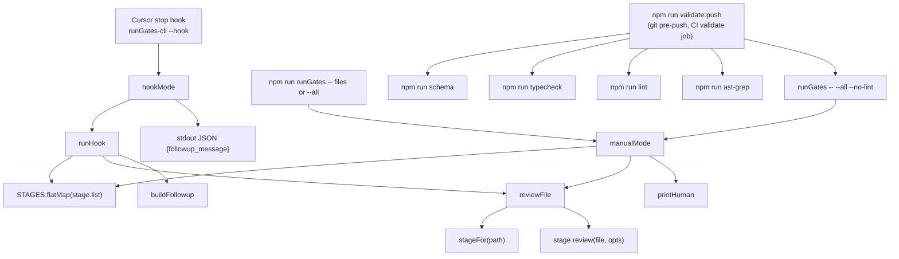
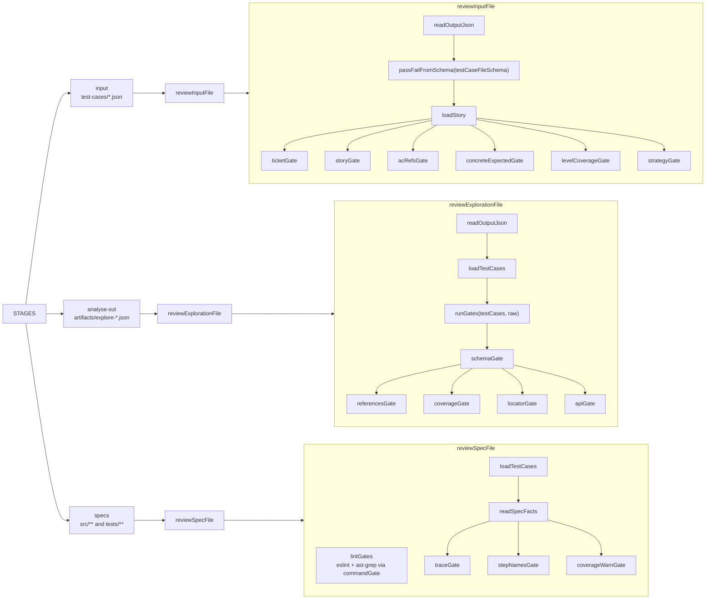
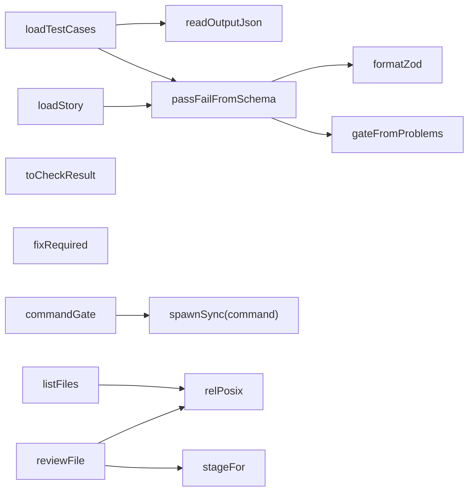
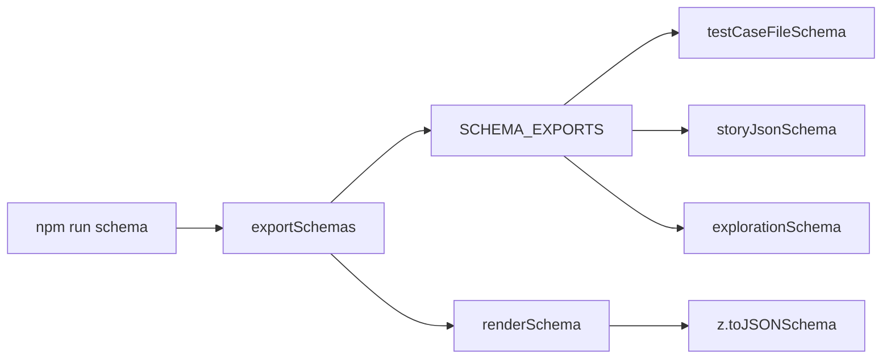
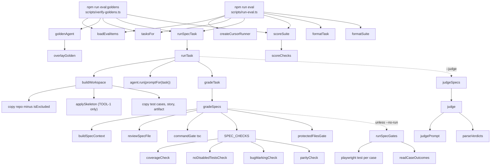

# Harness call graph

Generated from the code as of this commit. Section 1 is the real module import graph (produced by a script over `import` statements; dashed arrows are `import type`). Sections 2-6 are the function-level flows, read from the code.

## 1. Module imports

```mermaid
flowchart LR
  subgraph scripts["Entry scripts"]
    _agents_scripts_runGates_cli_ts["runGates-cli"]
    scripts_run_eval_ts["run-eval"]
    scripts_verify_goldens_ts["verify-goldens"]
  end
  subgraph lib["lib (generic)"]
    _agents_harness_config_ts["harness-config"]
    _agents_lib_eval_check_ts["check"]
    _agents_lib_eval_cursor_runner_ts["cursor-runner"]
    _agents_lib_eval_judge_ts["judge"]
    _agents_lib_eval_report_ts["report"]
    _agents_lib_eval_run_task_ts["run-task"]
    _agents_lib_eval_score_ts["score"]
    _agents_lib_export_schema_ts["export-schema"]
    _agents_lib_files_ts["files"]
    _agents_lib_gates_commandGate_ts["commandGate"]
    _agents_lib_gates_gateResults_ts["gateResults"]
  end
  subgraph pipe["manual-to-autotests-pipeline"]
    _agents_manual_to_autotests_pipeline_input_validation_input_schemas_ts["input-schemas"]
    _agents_manual_to_autotests_pipeline_input_validation_load_story_ts["load-story"]
    _agents_manual_to_autotests_pipeline_input_validation_load_test_cases_ts["load-test-cases"]
    _agents_manual_to_autotests_pipeline_input_validation_review_input_files_ts["review-input-files"]
    _agents_manual_to_autotests_pipeline_paths_ts["paths"]
    _agents_manual_to_autotests_pipeline_pipeline_config_ts["pipeline.config"]
    _agents_manual_to_autotests_pipeline_schema_exports_ts["schema-exports"]
    _agents_manual_to_autotests_pipeline_specs_validation_review_spec_file_ts["review-spec-file"]
    _agents_manual_to_autotests_pipeline_specs_validation_spec_gates_ts["spec-gates"]
    _agents_manual_to_autotests_pipeline_specs_validation_spec_source_ts["spec-source"]
  end
  subgraph skill["skills/analyse-sut"]
    _agents_skills_analyse_sut_scripts_gates_api_gate_ts["api-gate"]
    _agents_skills_analyse_sut_scripts_gates_coverage_gate_ts["coverage-gate"]
    _agents_skills_analyse_sut_scripts_gates_index_ts["index"]
    _agents_skills_analyse_sut_scripts_gates_locator_gate_ts["locator-gate"]
    _agents_skills_analyse_sut_scripts_gates_references_gate_ts["references-gate"]
    _agents_skills_analyse_sut_scripts_gates_schema_gate_ts["schema-gate"]
    _agents_skills_analyse_sut_scripts_gates_types_ts["types"]
    _agents_skills_analyse_sut_scripts_review_exploration_file_ts["review-exploration-file"]
    _agents_skills_analyse_sut_scripts_schema_ts["schema"]
  end
  subgraph evalp["pipeline eval"]
    _agents_manual_to_autotests_pipeline_eval_dataset_ts["dataset"]
    _agents_manual_to_autotests_pipeline_eval_golden_agent_ts["golden-agent"]
    _agents_manual_to_autotests_pipeline_eval_grade_ts["grade"]
    _agents_manual_to_autotests_pipeline_eval_judge_specs_ts["judge-specs"]
    _agents_manual_to_autotests_pipeline_eval_protected_files_ts["protected-files"]
    _agents_manual_to_autotests_pipeline_eval_run_specs_ts["run-specs"]
    _agents_manual_to_autotests_pipeline_eval_skeleton_ts["skeleton"]
    _agents_manual_to_autotests_pipeline_eval_spec_checks_ts["spec-checks"]
    _agents_manual_to_autotests_pipeline_eval_spec_context_ts["spec-context"]
    _agents_manual_to_autotests_pipeline_eval_spec_task_ts["spec-task"]
    _agents_manual_to_autotests_pipeline_eval_workspace_ts["workspace"]
  end
  _agents_lib_eval_judge_ts --> _agents_lib_eval_check_ts
  _agents_lib_eval_judge_ts -.-> _agents_lib_eval_cursor_runner_ts
  _agents_lib_eval_report_ts -.-> _agents_lib_eval_run_task_ts
  _agents_lib_eval_report_ts -.-> _agents_lib_eval_score_ts
  _agents_lib_eval_run_task_ts --> _agents_lib_eval_check_ts
  _agents_lib_eval_run_task_ts -.-> _agents_lib_eval_cursor_runner_ts
  _agents_lib_eval_score_ts -.-> _agents_lib_eval_check_ts
  _agents_lib_eval_score_ts -.-> _agents_lib_eval_run_task_ts
  _agents_lib_gates_commandGate_ts --> _agents_harness_config_ts
  _agents_lib_gates_commandGate_ts --> _agents_lib_gates_gateResults_ts
  _agents_manual_to_autotests_pipeline_eval_dataset_ts --> _agents_lib_files_ts
  _agents_manual_to_autotests_pipeline_eval_dataset_ts --> _agents_manual_to_autotests_pipeline_input_validation_input_schemas_ts
  _agents_manual_to_autotests_pipeline_eval_dataset_ts --> _agents_manual_to_autotests_pipeline_paths_ts
  _agents_manual_to_autotests_pipeline_eval_dataset_ts --> _agents_harness_config_ts
  _agents_manual_to_autotests_pipeline_eval_dataset_ts --> _agents_manual_to_autotests_pipeline_specs_validation_spec_source_ts
  _agents_manual_to_autotests_pipeline_eval_dataset_ts --> _agents_manual_to_autotests_pipeline_eval_skeleton_ts
  _agents_manual_to_autotests_pipeline_eval_golden_agent_ts -.-> _agents_lib_eval_cursor_runner_ts
  _agents_manual_to_autotests_pipeline_eval_golden_agent_ts -.-> _agents_manual_to_autotests_pipeline_eval_spec_task_ts
  _agents_manual_to_autotests_pipeline_eval_golden_agent_ts --> _agents_manual_to_autotests_pipeline_eval_workspace_ts
  _agents_manual_to_autotests_pipeline_eval_grade_ts --> _agents_harness_config_ts
  _agents_manual_to_autotests_pipeline_eval_grade_ts --> _agents_lib_gates_commandGate_ts
  _agents_manual_to_autotests_pipeline_eval_grade_ts --> _agents_lib_gates_gateResults_ts
  _agents_manual_to_autotests_pipeline_eval_grade_ts -.-> _agents_manual_to_autotests_pipeline_input_validation_input_schemas_ts
  _agents_manual_to_autotests_pipeline_eval_grade_ts --> _agents_manual_to_autotests_pipeline_specs_validation_review_spec_file_ts
  _agents_manual_to_autotests_pipeline_eval_grade_ts -.-> _agents_manual_to_autotests_pipeline_eval_dataset_ts
  _agents_manual_to_autotests_pipeline_eval_grade_ts --> _agents_manual_to_autotests_pipeline_eval_protected_files_ts
  _agents_manual_to_autotests_pipeline_eval_grade_ts --> _agents_manual_to_autotests_pipeline_eval_run_specs_ts
  _agents_manual_to_autotests_pipeline_eval_grade_ts --> _agents_manual_to_autotests_pipeline_eval_spec_context_ts
  _agents_manual_to_autotests_pipeline_eval_grade_ts --> _agents_manual_to_autotests_pipeline_eval_spec_checks_ts
  _agents_manual_to_autotests_pipeline_eval_judge_specs_ts -.-> _agents_lib_eval_check_ts
  _agents_manual_to_autotests_pipeline_eval_judge_specs_ts -.-> _agents_lib_eval_cursor_runner_ts
  _agents_manual_to_autotests_pipeline_eval_judge_specs_ts --> _agents_lib_eval_judge_ts
  _agents_manual_to_autotests_pipeline_eval_judge_specs_ts -.-> _agents_manual_to_autotests_pipeline_input_validation_input_schemas_ts
  _agents_manual_to_autotests_pipeline_eval_judge_specs_ts -.-> _agents_manual_to_autotests_pipeline_eval_dataset_ts
  _agents_manual_to_autotests_pipeline_eval_judge_specs_ts --> _agents_manual_to_autotests_pipeline_eval_spec_context_ts
  _agents_manual_to_autotests_pipeline_eval_protected_files_ts --> _agents_harness_config_ts
  _agents_manual_to_autotests_pipeline_eval_protected_files_ts --> _agents_lib_files_ts
  _agents_manual_to_autotests_pipeline_eval_protected_files_ts --> _agents_lib_gates_gateResults_ts
  _agents_manual_to_autotests_pipeline_eval_protected_files_ts --> _agents_manual_to_autotests_pipeline_paths_ts
  _agents_manual_to_autotests_pipeline_eval_protected_files_ts -.-> _agents_manual_to_autotests_pipeline_eval_dataset_ts
  _agents_manual_to_autotests_pipeline_eval_protected_files_ts --> _agents_manual_to_autotests_pipeline_eval_workspace_ts
  _agents_manual_to_autotests_pipeline_eval_run_specs_ts --> _agents_harness_config_ts
  _agents_manual_to_autotests_pipeline_eval_run_specs_ts --> _agents_lib_gates_commandGate_ts
  _agents_manual_to_autotests_pipeline_eval_run_specs_ts --> _agents_lib_gates_gateResults_ts
  _agents_manual_to_autotests_pipeline_eval_run_specs_ts -.-> _agents_manual_to_autotests_pipeline_eval_spec_context_ts
  _agents_manual_to_autotests_pipeline_eval_skeleton_ts --> _agents_harness_config_ts
  _agents_manual_to_autotests_pipeline_eval_skeleton_ts --> _agents_lib_files_ts
  _agents_manual_to_autotests_pipeline_eval_spec_checks_ts --> _agents_lib_gates_gateResults_ts
  _agents_manual_to_autotests_pipeline_eval_spec_checks_ts --> _agents_manual_to_autotests_pipeline_specs_validation_spec_source_ts
  _agents_manual_to_autotests_pipeline_eval_spec_checks_ts -.-> _agents_manual_to_autotests_pipeline_eval_spec_context_ts
  _agents_manual_to_autotests_pipeline_eval_spec_context_ts --> _agents_lib_files_ts
  _agents_manual_to_autotests_pipeline_eval_spec_context_ts --> _agents_skills_analyse_sut_scripts_schema_ts
  _agents_manual_to_autotests_pipeline_eval_spec_context_ts --> _agents_manual_to_autotests_pipeline_input_validation_input_schemas_ts
  _agents_manual_to_autotests_pipeline_eval_spec_context_ts --> _agents_manual_to_autotests_pipeline_paths_ts
  _agents_manual_to_autotests_pipeline_eval_spec_context_ts --> _agents_manual_to_autotests_pipeline_specs_validation_spec_source_ts
  _agents_manual_to_autotests_pipeline_eval_spec_context_ts --> _agents_manual_to_autotests_pipeline_eval_dataset_ts
  _agents_manual_to_autotests_pipeline_eval_spec_task_ts -.-> _agents_lib_eval_check_ts
  _agents_manual_to_autotests_pipeline_eval_spec_task_ts -.-> _agents_lib_eval_cursor_runner_ts
  _agents_manual_to_autotests_pipeline_eval_spec_task_ts --> _agents_lib_eval_run_task_ts
  _agents_manual_to_autotests_pipeline_eval_spec_task_ts -.-> _agents_lib_gates_gateResults_ts
  _agents_manual_to_autotests_pipeline_eval_spec_task_ts -.-> _agents_manual_to_autotests_pipeline_input_validation_input_schemas_ts
  _agents_manual_to_autotests_pipeline_eval_spec_task_ts --> _agents_manual_to_autotests_pipeline_paths_ts
  _agents_manual_to_autotests_pipeline_eval_spec_task_ts -.-> _agents_manual_to_autotests_pipeline_eval_dataset_ts
  _agents_manual_to_autotests_pipeline_eval_spec_task_ts --> _agents_manual_to_autotests_pipeline_eval_grade_ts
  _agents_manual_to_autotests_pipeline_eval_spec_task_ts --> _agents_manual_to_autotests_pipeline_eval_judge_specs_ts
  _agents_manual_to_autotests_pipeline_eval_spec_task_ts --> _agents_manual_to_autotests_pipeline_eval_workspace_ts
  _agents_manual_to_autotests_pipeline_eval_workspace_ts --> _agents_harness_config_ts
  _agents_manual_to_autotests_pipeline_eval_workspace_ts --> _agents_lib_files_ts
  _agents_manual_to_autotests_pipeline_eval_workspace_ts --> _agents_manual_to_autotests_pipeline_paths_ts
  _agents_manual_to_autotests_pipeline_eval_workspace_ts -.-> _agents_manual_to_autotests_pipeline_eval_dataset_ts
  _agents_manual_to_autotests_pipeline_eval_workspace_ts --> _agents_manual_to_autotests_pipeline_eval_skeleton_ts
  _agents_manual_to_autotests_pipeline_input_validation_load_story_ts --> _agents_manual_to_autotests_pipeline_paths_ts
  _agents_manual_to_autotests_pipeline_input_validation_load_story_ts --> _agents_manual_to_autotests_pipeline_input_validation_input_schemas_ts
  _agents_manual_to_autotests_pipeline_input_validation_load_story_ts --> _agents_lib_gates_gateResults_ts
  _agents_manual_to_autotests_pipeline_input_validation_load_test_cases_ts --> _agents_lib_files_ts
  _agents_manual_to_autotests_pipeline_input_validation_load_test_cases_ts --> _agents_lib_gates_gateResults_ts
  _agents_manual_to_autotests_pipeline_input_validation_load_test_cases_ts --> _agents_manual_to_autotests_pipeline_paths_ts
  _agents_manual_to_autotests_pipeline_input_validation_load_test_cases_ts --> _agents_manual_to_autotests_pipeline_input_validation_input_schemas_ts
  _agents_manual_to_autotests_pipeline_input_validation_review_input_files_ts --> _agents_lib_gates_gateResults_ts
  _agents_manual_to_autotests_pipeline_input_validation_review_input_files_ts --> _agents_lib_files_ts
  _agents_manual_to_autotests_pipeline_input_validation_review_input_files_ts --> _agents_manual_to_autotests_pipeline_paths_ts
  _agents_manual_to_autotests_pipeline_input_validation_review_input_files_ts --> _agents_manual_to_autotests_pipeline_input_validation_input_schemas_ts
  _agents_manual_to_autotests_pipeline_input_validation_review_input_files_ts --> _agents_harness_config_ts
  _agents_manual_to_autotests_pipeline_input_validation_review_input_files_ts --> _agents_manual_to_autotests_pipeline_input_validation_load_story_ts
  _agents_manual_to_autotests_pipeline_paths_ts --> _agents_harness_config_ts
  _agents_manual_to_autotests_pipeline_pipeline_config_ts -.-> _agents_lib_gates_gateResults_ts
  _agents_manual_to_autotests_pipeline_pipeline_config_ts --> _agents_harness_config_ts
  _agents_manual_to_autotests_pipeline_pipeline_config_ts --> _agents_lib_files_ts
  _agents_manual_to_autotests_pipeline_pipeline_config_ts --> _agents_manual_to_autotests_pipeline_input_validation_review_input_files_ts
  _agents_manual_to_autotests_pipeline_pipeline_config_ts --> _agents_skills_analyse_sut_scripts_review_exploration_file_ts
  _agents_manual_to_autotests_pipeline_pipeline_config_ts --> _agents_manual_to_autotests_pipeline_specs_validation_review_spec_file_ts
  _agents_manual_to_autotests_pipeline_schema_exports_ts --> _agents_harness_config_ts
  _agents_manual_to_autotests_pipeline_schema_exports_ts --> _agents_lib_export_schema_ts
  _agents_manual_to_autotests_pipeline_schema_exports_ts --> _agents_manual_to_autotests_pipeline_input_validation_input_schemas_ts
  _agents_manual_to_autotests_pipeline_schema_exports_ts --> _agents_skills_analyse_sut_scripts_schema_ts
  _agents_manual_to_autotests_pipeline_specs_validation_review_spec_file_ts --> _agents_lib_gates_commandGate_ts
  _agents_manual_to_autotests_pipeline_specs_validation_review_spec_file_ts --> _agents_lib_gates_gateResults_ts
  _agents_manual_to_autotests_pipeline_specs_validation_review_spec_file_ts --> _agents_lib_files_ts
  _agents_manual_to_autotests_pipeline_specs_validation_review_spec_file_ts --> _agents_manual_to_autotests_pipeline_paths_ts
  _agents_manual_to_autotests_pipeline_specs_validation_review_spec_file_ts --> _agents_manual_to_autotests_pipeline_input_validation_load_test_cases_ts
  _agents_manual_to_autotests_pipeline_specs_validation_review_spec_file_ts --> _agents_harness_config_ts
  _agents_manual_to_autotests_pipeline_specs_validation_review_spec_file_ts --> _agents_manual_to_autotests_pipeline_specs_validation_spec_gates_ts
  _agents_manual_to_autotests_pipeline_specs_validation_review_spec_file_ts --> _agents_manual_to_autotests_pipeline_specs_validation_spec_source_ts
  _agents_manual_to_autotests_pipeline_specs_validation_spec_gates_ts --> _agents_lib_gates_gateResults_ts
  _agents_manual_to_autotests_pipeline_specs_validation_spec_gates_ts -.-> _agents_manual_to_autotests_pipeline_input_validation_input_schemas_ts
  _agents_manual_to_autotests_pipeline_specs_validation_spec_gates_ts --> _agents_manual_to_autotests_pipeline_specs_validation_spec_source_ts
  _agents_manual_to_autotests_pipeline_specs_validation_spec_source_ts -.-> _agents_manual_to_autotests_pipeline_input_validation_input_schemas_ts
  _agents_manual_to_autotests_pipeline_specs_validation_spec_source_ts --> _agents_harness_config_ts
  _agents_scripts_runGates_cli_ts --> _agents_lib_gates_gateResults_ts
  _agents_scripts_runGates_cli_ts --> _agents_lib_files_ts
  _agents_scripts_runGates_cli_ts --> _agents_manual_to_autotests_pipeline_pipeline_config_ts
  _agents_skills_analyse_sut_scripts_gates_api_gate_ts --> _agents_skills_analyse_sut_scripts_gates_types_ts
  _agents_skills_analyse_sut_scripts_gates_coverage_gate_ts --> _agents_skills_analyse_sut_scripts_gates_types_ts
  _agents_skills_analyse_sut_scripts_gates_index_ts --> _agents_skills_analyse_sut_scripts_gates_schema_gate_ts
  _agents_skills_analyse_sut_scripts_gates_index_ts --> _agents_skills_analyse_sut_scripts_gates_locator_gate_ts
  _agents_skills_analyse_sut_scripts_gates_index_ts --> _agents_skills_analyse_sut_scripts_gates_references_gate_ts
  _agents_skills_analyse_sut_scripts_gates_index_ts --> _agents_skills_analyse_sut_scripts_gates_coverage_gate_ts
  _agents_skills_analyse_sut_scripts_gates_index_ts --> _agents_skills_analyse_sut_scripts_gates_api_gate_ts
  _agents_skills_analyse_sut_scripts_gates_index_ts -.-> _agents_lib_gates_gateResults_ts
  _agents_skills_analyse_sut_scripts_gates_index_ts -.-> _agents_manual_to_autotests_pipeline_input_validation_input_schemas_ts
  _agents_skills_analyse_sut_scripts_gates_locator_gate_ts --> _agents_skills_analyse_sut_scripts_gates_types_ts
  _agents_skills_analyse_sut_scripts_gates_references_gate_ts --> _agents_skills_analyse_sut_scripts_gates_types_ts
  _agents_skills_analyse_sut_scripts_gates_schema_gate_ts --> _agents_lib_gates_gateResults_ts
  _agents_skills_analyse_sut_scripts_gates_schema_gate_ts --> _agents_skills_analyse_sut_scripts_schema_ts
  _agents_skills_analyse_sut_scripts_gates_schema_gate_ts -.-> _agents_skills_analyse_sut_scripts_gates_types_ts
  _agents_skills_analyse_sut_scripts_gates_types_ts -.-> _agents_skills_analyse_sut_scripts_schema_ts
  _agents_skills_analyse_sut_scripts_gates_types_ts -.-> _agents_manual_to_autotests_pipeline_input_validation_input_schemas_ts
  _agents_skills_analyse_sut_scripts_gates_types_ts -.-> _agents_lib_gates_gateResults_ts
  _agents_skills_analyse_sut_scripts_review_exploration_file_ts --> _agents_lib_gates_gateResults_ts
  _agents_skills_analyse_sut_scripts_review_exploration_file_ts --> _agents_lib_files_ts
  _agents_skills_analyse_sut_scripts_review_exploration_file_ts --> _agents_manual_to_autotests_pipeline_paths_ts
  _agents_skills_analyse_sut_scripts_review_exploration_file_ts --> _agents_manual_to_autotests_pipeline_input_validation_load_test_cases_ts
  _agents_skills_analyse_sut_scripts_review_exploration_file_ts --> _agents_skills_analyse_sut_scripts_gates_index_ts
  _agents_skills_analyse_sut_scripts_schema_ts --> _agents_manual_to_autotests_pipeline_input_validation_input_schemas_ts
  scripts_run_eval_ts --> _agents_harness_config_ts
  scripts_run_eval_ts --> _agents_lib_eval_cursor_runner_ts
  scripts_run_eval_ts --> _agents_lib_eval_report_ts
  scripts_run_eval_ts -.-> _agents_lib_eval_run_task_ts
  scripts_run_eval_ts --> _agents_lib_eval_score_ts
  scripts_run_eval_ts --> _agents_manual_to_autotests_pipeline_eval_dataset_ts
  scripts_run_eval_ts --> _agents_manual_to_autotests_pipeline_eval_spec_task_ts
  scripts_verify_goldens_ts --> _agents_lib_eval_cursor_runner_ts
  scripts_verify_goldens_ts --> _agents_lib_eval_report_ts
  scripts_verify_goldens_ts -.-> _agents_lib_eval_run_task_ts
  scripts_verify_goldens_ts --> _agents_lib_eval_score_ts
  scripts_verify_goldens_ts --> _agents_manual_to_autotests_pipeline_eval_dataset_ts
  scripts_verify_goldens_ts --> _agents_manual_to_autotests_pipeline_eval_golden_agent_ts
  scripts_verify_goldens_ts --> _agents_manual_to_autotests_pipeline_eval_spec_task_ts
```

## 2. Entry points



`--hook` never lints (lint runs once in `validate:push`); `runGates <file>` lints spec files unless `--no-lint`.

## 3. Stage registry and the three reviews



`toCheckResult` turns each review's gate list into `decision: fix_required | continue`; a failed read or parse returns early through `fixRequired`.

## 4. Shared helpers



## 5. Schema export



## 6. Eval



Judge output is advisory and never affects `passed`; only the deterministic checks do.
