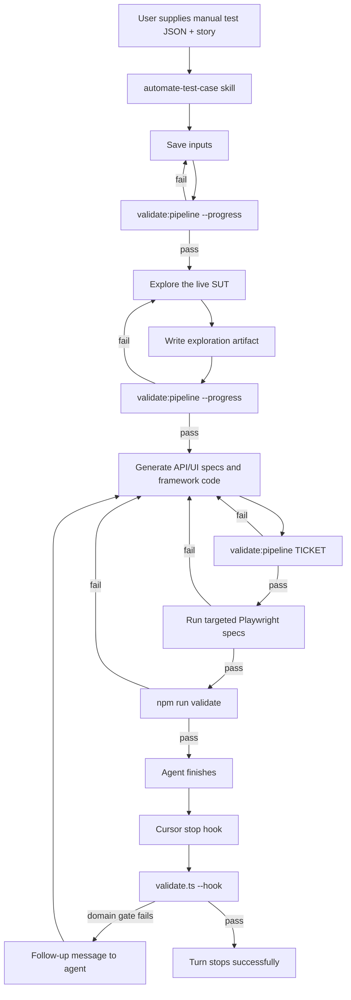
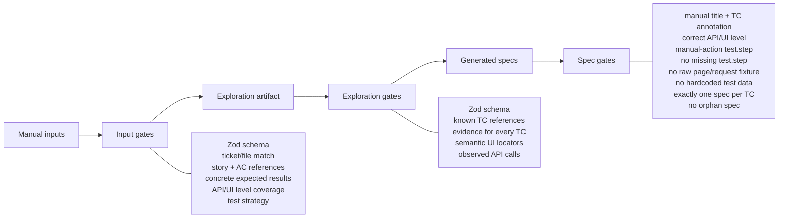
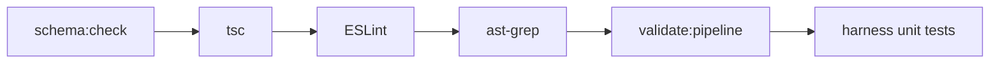
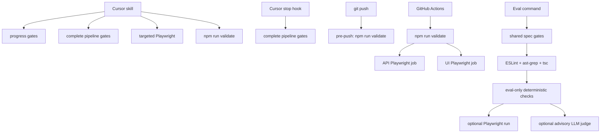

# Gate flow

## One Cursor request

The stop hook retries at most three times. It runs the custom pipeline gates only; the skill runs targeted Playwright and full `npm run validate` before reporting completion.

## What `validate:pipeline` checks

- `--progress`: validates what exists without demanding the complete final output.
- Default/`--hook`: requires the exploration artifact and complete test-case coverage.
- Failures are named and returned to the agent as actionable follow-up text.

## Full repository validation

`npm run validate` runs these in order:

- **Schema check:** committed JSON Schema exports still match the Zod schemas.
- **TypeScript:** framework and harness compile.
- **ESLint:** TypeScript/Playwright rules and specs importing only from `@fixtures`.
- **ast-grep:** local forbidden code shapes such as fixed waits, inline timeouts, direct navigation/locators, weak response checks, empty steps, and status literals.
- **Pipeline:** input, exploration, traceability, fixture-injection, test-data, and coverage gates.
- **Harness tests:** passing and failing examples for the custom gates and ast-grep rules.

Playwright execution is separate from `npm run validate`.

## When each entry point runs

## Eval additions

Reusable task execution, command gates, judge parsing, and Playwright report parsing live in `.agents/lib/eval/`. The concrete spec dataset, workspace builder, graders, and rubric live in `.agents/manual-to-autotests-pipeline/eval/`.

The concrete eval reuses the normal spec gates, then adds:

- no disabled tests;
- correct `test.fail` use for known product gaps;
- parity with golden HTTP statuses and assertion strength;
- protected-file checks;
- optional per-test-case Playwright execution;
- optional advisory assertion-quality judge.

The judge never changes deterministic pass/fail.
